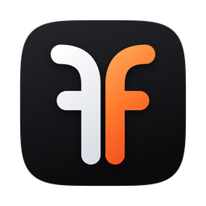
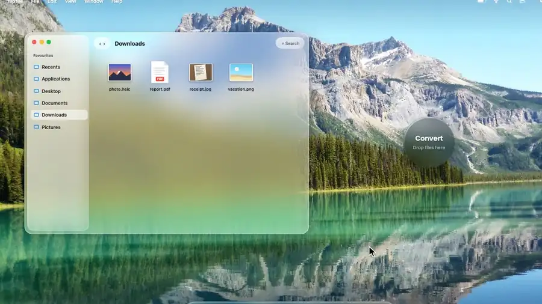
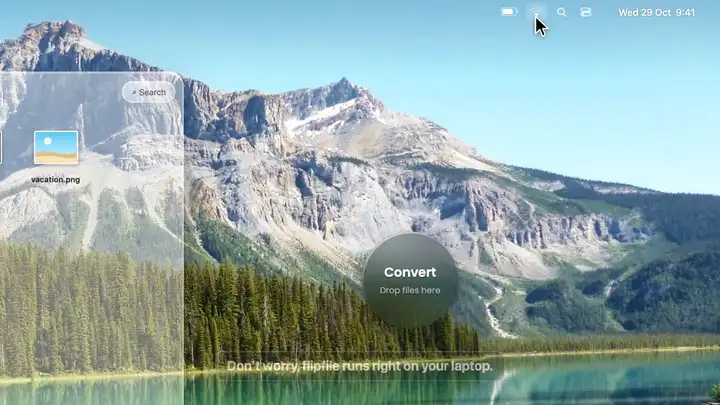
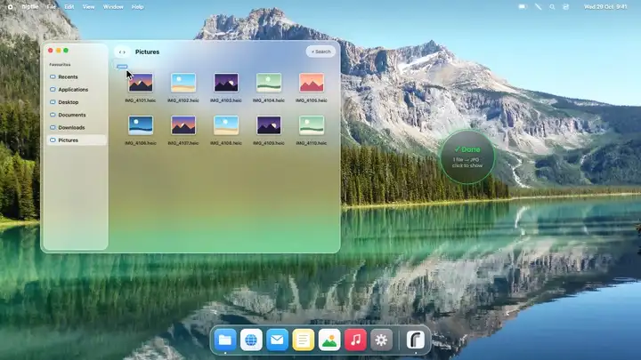
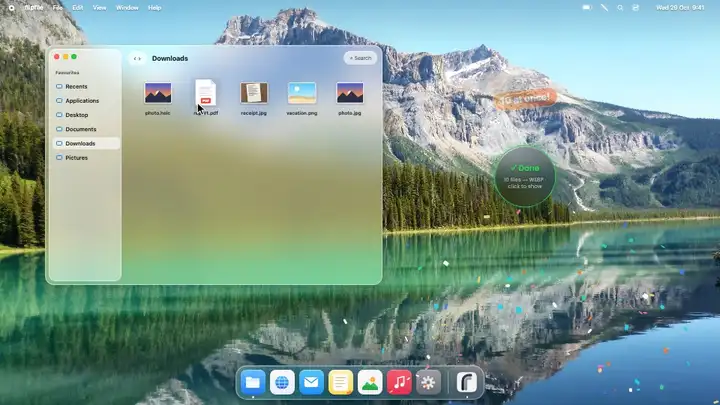
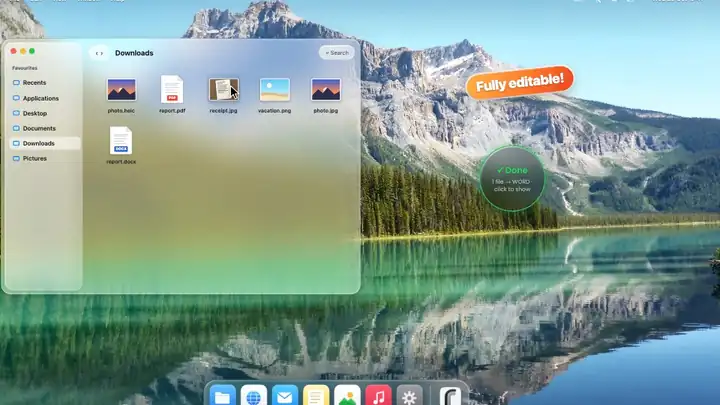
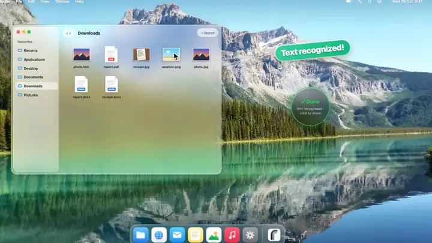
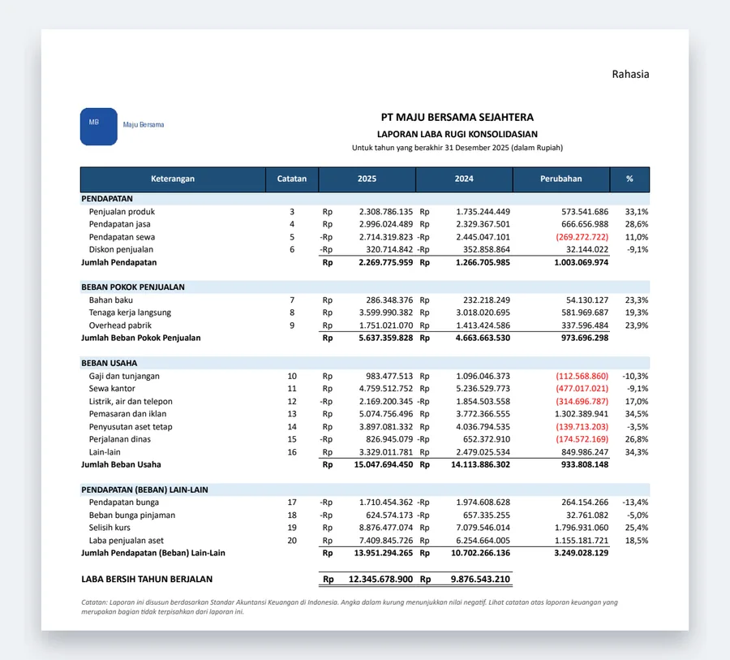

<div align="center">



# flipfile

**Drop a file. Point to a format. Done.**

A tiny file converter that lives on your desktop.<br>
Photos, PDFs, Word, Excel, PowerPoint, data, video, audio and scans — converted right on your computer.<br>
No uploads. No accounts. No waiting.

[](https://github.com/wcksnrdn/flipfile/releases/latest)
[](https://github.com/wcksnrdn/flipfile/actions/workflows/ci.yml)
[](https://github.com/wcksnrdn/homebrew-tap)
[](https://github.com/microsoft/winget-pkgs/pull/471276)
[](LICENSE)


<br>



<br>

[**Download**](https://github.com/wcksnrdn/flipfile/releases/latest) &nbsp;·&nbsp; [See it in action](#see-it-in-action) &nbsp;·&nbsp; [How to use](#how-to-use) &nbsp;·&nbsp; [Formats](#supported-formats)

</div>

<br>

## Why flipfile

| **Private by design** | **Instant** | **Does the boring stuff** |
|---|---|---|
| Every conversion runs on your computer. Files never leave it, and flipfile keeps working with the Wi-Fi off. | No upload, no queue, no "your download will start in 30 seconds". Drop, point, done. | iPhone HEIC ⇄ JPG/PNG/WEBP/AVIF, remove background, compress to exact KB/MB, PDF ⇄ Word, Excel → PDF, PowerPoint ⇄ PDF/Word/images/docs, CSV/JSON/YAML/SQL/Excel, video & audio, scans → editable text, multi-size ICO/ICNS, animated GIF. |

<br>

## See it in action

<table>
<tr>
<td width="50%" valign="top">

**Drag, point, let go**<br>
<sub>Move toward a format, its slice lights up, release. The result lands next to the original.</sub>


</td>
<td width="50%" valign="top">

**Works offline**<br>
<sub>Turn the Wi-Fi off: everything still converts, because nothing is ever uploaded.</sub>



</td>
</tr>
<tr>
<td width="50%" valign="top">

**A whole batch at once**<br>
<sub>Select ten photos, drop them together, watch them finish one by one.</sub>



</td>
<td width="50%" valign="top">

**PDF → Word you can edit**<br>
<sub>Tables, columns, headers and pictures are rebuilt, not pasted as images.</sub>



</td>
</tr>
<tr>
<td width="50%" valign="top">

**Scans and photos → text**<br>
<sub>WORD OCR reads receipts and scanned pages with your computer's own text recognition.</sub>



</td>
<td width="50%" valign="top">

**Resize and compress**<br>
<sub>Hold ⌥ Option (Alt on Windows) while dragging for 4K, 1080p, 720p, 50% or a smaller file.</sub>



</td>
</tr>
</table>

### Excel → PDF that looks like Excel printed it



Drop a workbook on **PDF** and every visible sheet prints the way Excel prints it: page setup and fit to page, repeated title rows, headers and footers with page numbers, merged cells, borders and fills, logos, and **number formats exactly as Excel shows them**, including accounting and Rupiah formats with negatives in brackets.

Separators follow your region (1.234.567,89 in Indonesia, 1,234,567.89 in the US), and dates follow your language.

Excel or LibreOffice are used when installed; otherwise flipfile's own engine does it. Nothing to install either way.

<br clear="right">

### AI Summary: drop a document, get the gist

No time to read a 40-page report? Drop it on **AI ✦** in the lobby. A glass panel opens beside the circle and **Apple Intelligence** explains the document while you watch: what kind of document it is, a headline, the one thing to know, the key points, the key figures (amounts, dates and deadlines stand out), the to-dos with who and when, and its topics.

- **Any document**: PDF, Word, PowerPoint, Excel, Markdown, web pages, e-books, and scans or photos of text (read with text recognition first).
- **Long ones too**: a long document is read part by part, and you see the notes it takes as it goes; a book is condensed to its most telling passages first, so even that takes about a minute.
- **Ask it anything**: type a question about the document, or tap one of the questions it suggests, and get an answer from the document itself (or a plain "the document doesn't say").
- **Your language**: the summary is written in the document's own language (Indonesian included), and one click translates it into your Mac's language and back.
- **Keep it**: copy it (`⌘C`), or save it next to the original as `name_summary.md` (`⌘S`). Drop another file on the panel to summarize that one.
- **Private**: Apple's on-device model writes it. The document never leaves your Mac, and it works with the Wi-Fi off.

Needs a Mac with Apple silicon, macOS 26 or later and Apple Intelligence turned on (*System Settings → Apple Intelligence & Siri*). Elsewhere the slice simply isn't there.

### AI Upscale: old photos, faces sharp again

Drop a small, blurry or old photo on **Upscale 2×** or **Upscale 4×** (*Photo → Tools*) and flipfile redraws it two or four times larger. Faces get their own AI: every face is restored, with eyes, lashes, brows, lips, skin and hair drawn back in, while the person keeps their own face (their eye colour, skin tone and features stay theirs).

- **Faces in HD**: each face is found (by Vision on the Mac, by [YuNet](https://github.com/opencv/opencv_zoo/tree/main/models/face_detection_yunet) on Windows and Linux) and drawn by an AI trained on faces, [4xFaceUpSharpLDAT](https://github.com/Phhofm/models/releases/tag/4xFaceUpDAT_Series): sharp eyes, lashes, brows, hair and skin, while glasses, jewellery and the person's own features stay exactly as they are. Small or damaged faces (old photos, faces in a crowd) are first restored by [RestoreFormer++](https://github.com/wzhouxiff/RestoreFormerPlusPlus). Faces blend back in seamlessly, even when several touch.
- **Everything else, sharper**: [Real-ESRGAN](https://github.com/xinntao/Real-ESRGAN) x4plus brings back natural detail in small photos; large pictures use its fast compact model. Edges and text come out crisp, JPEG blocks and noise disappear.
- **Old photos too**: a picture that is large but blurry (an old photo shown bigger than it was taken, a screenshot of one, an enlarged image) is recognised and read at the size its detail really has, so it comes back sharper instead of just bigger.
- **Your format**: `photo_2x.jpg` stays a JPG, `logo_4x.png` keeps its transparency (icons and GIFs come out as PNG).
- **Private and offline**: the models (about 140 MB, part of flipfile) run on your computer: on a Mac's Neural Engine, on Windows on the graphics card (any DirectX 12 GPU, built-in ones too, through DirectML), on Linux on the processor. Nothing is uploaded, nothing extra is downloaded, and nothing needs installing.
- **As fast as your computer allows**: on a Mac with Apple silicon a small photo takes a few seconds and Full HD to 4K about 15 (the circle shows how far it has got). flipfile measures how quick your computer is and uses the detailed model only where it finishes in reasonable time: without a capable GPU (Linux, Windows without one, Intel Macs), most pictures get the fast model and the faces are still restored.
- It draws plausible detail rather than recovering what the camera never captured. Results are limited to 200 megapixels, which lets a typical 50 MP camera photo through at 2× and a 12.5 MP phone photo at 4×.

macOS 13 Ventura or later, Windows 10 or later, Linux.

<br>

## Download

Get the latest version from **[Releases](https://github.com/wcksnrdn/flipfile/releases/latest)**:

| Your computer | Installation / File |
|---|---|
| macOS (Apple Silicon & Intel) | `brew install wcksnrdn/tap/flipfile` |
| Windows 10 / 11 | `winget install wcksnrdn.flipfile` · `flipfile_x.y.z_x64-setup.exe` |
| Mac with Apple Silicon (M1 to M4) | `flipfile_x.y.z_aarch64.dmg` |
| Mac with Intel | `flipfile_x.y.z_x64.dmg` |
| Linux | Debian/Ubuntu `.deb` &nbsp;·&nbsp; Fedora `.rpm` &nbsp;·&nbsp; any distro `.AppImage` |

### Install via Package Manager

```bash
# macOS (Homebrew)
brew install wcksnrdn/tap/flipfile
```

```powershell
# Windows 10 / 11 (Winget)
winget install wcksnrdn.flipfile
```

Or install with a single command:

```bash
# macOS & Linux
curl -fsSL https://raw.githubusercontent.com/wcksnrdn/flipfile/main/scripts/install.sh | sh
```

```powershell
# Windows 10 / 11 (PowerShell)
irm https://raw.githubusercontent.com/wcksnrdn/flipfile/main/scripts/install.ps1 | iex
```

<details>
<summary><b>First launch: "can't be verified" or "Windows protected your PC"</b></summary>

flipfile isn't notarized by Apple or code-signed for Windows yet, so the first launch needs one extra click:

- **macOS**: open flipfile, click **Done**, then go to **System Settings → Privacy & Security** and click **Open Anyway**. Only once.
- **Windows**: click **More info → Run anyway**.
- **Linux**: `sudo apt install ./flipfile_*.deb`, `sudo dnf install ./flipfile-*.rpm`, or `chmod +x` the AppImage and run it.

</details>

<br>

## How to use

1. **Drag** files onto the glass circle. The **category lobby** opens around it (**Photo · Office · Video · Music**, and **AI ✦ summary** on Macs with Apple Intelligence).
2. **Point** toward a room to enter it, then point toward a format or tool. Each **Back ‹** slice sits right where you entered from, so moving back is effortless.
3. **Let go.** The converted file appears next to the original. Click the circle to show it.

| Ring | Items |
|---|---|
| **Category Lobby** | **Photo** · **Office** · **Video** · **Music** · **AI ✦** *(summary, macOS)* |
| **Photo** | JPG · PNG · WEBP · HEIC *(macOS)* · PDF · **Formats •••** · **Tools ✦** · **Back ‹** |
| **Photo → Formats** | AVIF · TIFF · GIF · BMP · ICO *(multi)* · ICNS *(macOS)* · **Pro / 3D •••** · **Back ‹** |
| **Photo → Formats → Pro / 3D** | JPEG · TGA *(game)* · EXR *(32f HDR)* · HDR *(RGBE)* · QOI *(fast)* · PPM *(netpbm)* · SVG *(embed)* · **Back ‹** |
| **Photo → Tools** | **Compress** · **Remove BG** *(macOS)* · **Transform** · **Square 1:1** · **GIF anim** · **Clean EXIF** · **Back ‹** |
| **Photo → Compress** | Auto · **1 MB** max · **500 KB** max · **200 KB** max · **100 KB** max · **Lossless** · **Back ‹** |
| **Photo → Transform** | Rotate 90° › · Rotate ‹ 90° · Rotate 180° · Flip horiz · Flip vert · B&W gray · **Back ‹** |
| **Office** | PDF · WORD *(docx)* · **WORD OCR** · EXCEL *(xlsx)* · **SLIDES** *(pptx)* · CSV · **Docs •••** · **Data •••** · **Back ‹** |
| **Office → Docs** | MD *(markdown)* · TXT *(plain)* · HTML *(web)* · RTF *(rich text)* · EPUB *(e-book)* · ODT *(open doc)* · **Back ‹** |
| **Office → Data** | JSON · TSV *(tabs)* · YAML · XML · SQL *(insert)* · MD *(table)* · **Back ‹** |
| **Video** | MP4 · MOV · WEBM · MKV · AVI · **GIF** *(clip)* · **Tools ✦** · **Back ‹** |
| **Video → Tools** | **Compress** *(smaller)* · **Mute** *(no audio)* · **Audio** *(extract)* · **1080p** *(Full HD)* · **720p** *(HD)* · FLV · **Back ‹** |
| **Music** | MP3 · WAV · M4A *(AAC)* · FLAC · OGG · **More •••** · **Back ‹** |
| **Music → More** | AIFF *(studio)* · OPUS · AAC · CAF *(Apple)* · ALAC *(lossless)* · WMA · **Back ‹** |

Also handy: **⌘, / Ctrl+,** opens the **Ring Workshop** to customise your rings and workspace profiles, **⌘V / Ctrl+V** pastes an image or copied files, **⌘⇧K / Ctrl+Shift+K** shows or hides flipfile from anywhere, and the menu bar / tray icon keeps your recent conversions with **Undo**.

<details>
<summary><b>Ring Workshop (⌘, / Ctrl+, — customise rings & workspace profiles)</b></summary>

Press **⌘,** (macOS) or **Ctrl+,** (Windows/Linux), or pick **Ring Workshop…** from the tray menu, to arrange the rings around the way you work:

- **Two drag modes**:
  - **4 Rooms (Default)**: dragging opens the **Photo · Office · Video · Music** lobby first, and every room's ring can be reordered or edited.
  - **Direct Ring (3–10 slots)**: dragging opens your own single ring right away—mix any photo format, smart tool, Office/data format, video/audio action or room shortcut on one wheel.
- **Built-in profiles**: *4 Rooms (Default)*, *My Custom Ring*, *Designer & Web*, *Developer & Data*, *Office & Docs* and *Creator & Media*, plus as many custom workspaces as you like.
- **Full 70+ item catalog**: filter by category (*Photo*, *Photo Tools*, *Office & Docs*, *Data & Sheets*, *Video*, *Music*, *Sub-Rings*) and click or drag items into any slot with a live interactive preview.

</details>

<details>
<summary><b>In-App Auto-Updater (Check & install updates with 1 click)</b></summary>

flipfile includes a native, cryptographically signed auto-updater powered by Tauri 2:
- **Background Startup Check**: A few seconds after launching, flipfile quietly checks GitHub Releases for new updates in the background without slowing down your startup.
- **Manual Check Anytime**: Click **Check for Updates…** from the menu bar / system tray menu, or click the **Updates** button in the Ring Workshop header.
- **One-Click Update**: If a new version is available, a glass update dialog appears with release notes. Clicking **Update Now** downloads the installer and relaunches the app automatically into the latest version.
- **Minisign Cryptographic Verification**: Every release binary is signed and verified with cryptographic keypairs to ensure tamper-proof security and authenticity.

</details>

<details>
<summary><b>Photo tools & Pro / 3D formats (Remove BG, target-size compress, transform, square, animated GIF, EXR/HDR/TGA/QOI/SVG)</b></summary>

- **Remove BG** *(macOS 14+)*: uses macOS Vision's built-in subject-lifting model (`VNGenerateForegroundInstanceMaskRequest`) completely offline to cut out the foreground subject and save a transparent PNG (`photo_nobg.png`).
- **Upscale 2× / 4×**: Real-ESRGAN (x4plus up to Full HD when this computer is quick enough, as measured tile by tile; compact otherwise), tile by tile with overlapping margins so no seams show; 2× is the 4× result averaged down. Large but blurry pictures (detected by how little they lose when halved) are halved first. Faces (Vision on macOS, YuNet elsewhere): large ones (eyes 64 px apart or more) are drawn straight from the picture by 4xFaceUpSharpLDAT (DAT, a transformer trained on faces; 128 px tiles, on the GPU), small ones aligned to a 512 px template, restored by RestoreFormer++, then enlarged by 4xFaceUpSharpLDAT; each is blended back over an ellipse. The face upscaler is used where it fits in 45 s a face (2 min a picture) on this computer, else faces are only restored. macOS runs the models with Core ML (Neural Engine, CPU); Windows and Linux with ONNX Runtime (DirectML GPU on Windows, CPU on Linux). Keeps the file's format and transparency (`photo_2x.jpg`); the result (input × factor²) is limited to 200 MP.
- **Compress to target size** (**1 MB · 500 KB · 200 KB · 100 KB**): binary-searches encoder quality (and progressively scales resolution down if needed) so the output strictly fits under your byte budget—ideal for web forms and upload portals.
- **Lossless compress**: runs `oxipng` on PNGs, strips metadata losslessly from JPEGs, writes lossless WebP, or Deflate-compresses TIFFs without changing a single pixel.
- **Transform**: rotate 90° clockwise, 90° counter-clockwise, 180°, flip horizontally or vertically, or convert to grayscale (B&W) in the file's own format.
- **Square 1:1**: pads non-square photos to a 1:1 square without cropping (transparent backdrop for PNG/WEBP/AVIF/TIFF, white backdrop for JPG/BMP).
- **GIF anim**: drop several photos onto **GIF anim** to combine them into a looping animated GIF (`first_animated.gif`).
- **Slides (`pptx`)**: drop one photo to put it on a 16:9 PowerPoint slide, or drop several photos together to combine them into a single presentation (`first_merged.pptx`).
- **Multi-size ICO & macOS ICNS**: **ICO** packs `16, 32, 48, 64, 128, 256` px slices into one Windows icon; **ICNS** packs `16` through `1024` px retina slices (`icp4`–`ic10`) for macOS app bundles.
- **Pro / 3D & Vector formats**: write **TGA** (game/VFX textures), **OpenEXR** (`.exr`, 32-bit float HDR), **Radiance HDR** (`.hdr`, RGBE), **QOI** (fast lossless), **PPM** (Netpbm) and **SVG** (embedded vector wrapper); read **PSD** (Photoshop), **JP2 / JPEG 2000** and **camera RAW** (`.dng`, `.cr2`, `.cr3`, `.nef`, `.arw`, `.orf`, `.rw2`, `.raf`) via the operating system's codecs.

</details>

<details>
<summary><b>Word ↔ PDF</b></summary>

- **Word → PDF**: drop a `.docx` on **PDF**. Several Word files become one PDF each. Dropping a Word file on an image format gives one image per page.
- **PDF → Word**: drop a PDF on **WORD** to get an editable `.docx`.

How Word → PDF is done, best first:

| Engine | When | Result |
|---|---|---|
| Microsoft Word | Installed (Windows) | Identical to printing from Word. Word runs invisibly and is closed again afterwards. (Not used on macOS: Word for Mac is sandboxed and cannot save files for other apps.) |
| LibreOffice | Installed (any OS) | Very close to Word, run invisibly with a private profile |
| **Built-in** | Always | flipfile's own engine: reads the document (styles, fonts, lists, tables with merged cells and repeating header rows, images, text boxes, headers and footers with page numbers, tab stops, equation text) and lays it out with the [Typst](https://typst.app) typesetting engine. Page layout follows Word's own rules: every line is as tall as Word makes it for that font (its real ascent/descent), headers and footers are measured so the body starts where Word starts it, table rows include their borders and the cell padding of the table style, tables wider than the text extend into the margins, pictures fixed to the page or in front of text float, and tables of contents get live page numbers. Page breaks therefore land where Word puts them. Very specialised Word features (SmartArt, charts, tracked-change markup) are simplified. |

The user is never asked to install anything. Old binary `.doc` files need Word or LibreOffice; without them flipfile asks to save the file as `.docx`.

PDF → Word rebuilds the document from the PDF's layout, in the spirit of pdf2docx, and keeps every page on its own page with the same size and orientation:

- **Tables**: ruling lines that form a grid become real Word tables, with merged cells, borders per cell side, cell shading and row heights; tables drawn with row rules only (common in journals) and tables nested inside a cell are recognised too. Text inside cells keeps its line breaks, so rows stay as tall as in the PDF.
- **Text**: characters become lines and paragraphs with alignment, indents, exact line spacing and the spacing between paragraphs; fonts, sizes, bold, italic, underline, colour, superscript/subscript and letter-spacing are kept. Wide gaps become tabs with matching tab stops, and dotted leaders in tables of contents become real dot-leader tabs. Lines the PDF squeezed to fit are condensed slightly, so they wrap where they did.
- **Header and footer**: content repeated at the top/bottom of the pages becomes the Word header/footer; the page number becomes a live page field (also when a journal's numbering starts at e.g. 2348).
- **Layout**: blocks side by side (two-column pages, a picture beside text) are kept side by side in borderless tables, a whole column per cell. Pictures stay where they were; a picture exported in strips or tiles (a logo cut in four) is put back together at full resolution, and vector diagrams (charts, flowcharts) become pictures rendered from the page.
- **Fonts**: a font the computer lacks is replaced by the Office font of the same kind (Liberation/Tinos → Times New Roman, Arimo → Arial, Carlito → Calibri, …, or by the PDF's own serif/sans/mono description), and lines squeezed by the PDF get slightly condensed characters, so every line wraps where it did.
- **Design**: coloured bands, boxes, bars, icons, page-size artwork (covers, certificates), annotations and stamps are drawn as a picture behind the text, so the page looks like the original while the text stays editable.

Pages filled to the bottom edge get their gaps tightened by a few points, so nothing spills onto an extra page; on a test set of 30 varied PDFs (reports, journals, books, invoices, certificates, infographics, slides) every converted document has exactly as many pages as the original. Pictures are kept at most at 300 dpi of their size on the page, photo backgrounds are stored as JPEG, so the Word file is usually no bigger than the PDF.

Scanned pages without text are kept as page images by **WORD**; use **WORD OCR** to get their text.

</details>

<details>
<summary><b>Excel → PDF</b></summary>

Drop an Excel workbook (`.xlsx`, `.xlsm`) or a `.csv` on **PDF**; on an image format it gives one image per page. Like Word → PDF, Microsoft Excel (Windows) or LibreOffice are used when installed; otherwise flipfile's built-in engine prints the workbook itself, so nothing has to be installed. Old `.xls` and `.ods` files need Excel or LibreOffice.

The built-in engine prints what Excel would print:

- **Every visible sheet**, each with its own page setup: paper size (A4, Letter, Legal, F4, …), orientation, margins, scale or *fit to N pages wide/tall*, centring, print area, rows repeated at the top of each page, manual page breaks, page order, and header/footer with page numbers (`&P`, `&N`), sheet and file name. Hidden sheets, rows and columns don't print.
- **Numbers as Excel shows them**: Excel's number formats are reproduced, including accounting and currency formats (`Rp`, `$`, the symbol at the cell's left edge and negatives in brackets), `[Red]` negatives, percentages, thousands scaling, scientific notation, fractions, and dates and times. Thousands and decimal separators follow the computer's region (1.234.567,89 in Indonesia, 1,234,567.89 in the US), and day/month names follow its language. Formulas print their last calculated result, as stored by Excel.
- **The look of the sheet**: column widths and row heights in Excel's own units, fonts, fills, borders (thin, thick, double, dashed, …), merged cells, alignment and indents, wrapped text (rows without a fixed height grow to fit it), pictures such as logos, and printed gridlines when the sheet asks for them. Text spills into empty neighbouring cells, numbers that don't fit show `####`, as in Excel.
- **CSV** files print as a table with gridlines and a bold header row; `,` `;` tab and `|` separators are detected, and codes with leading zeros stay as written.

Charts, shapes and conditional formatting are not drawn by the built-in engine yet.

</details>

<details>
<summary><b>PowerPoint ↔ PDF, Word, images, documents and tables</b></summary>

- **PowerPoint → PDF / images**: drop a `.pptx` (or `.ppsx`, `.potx`, `.pptm`) on **PDF** or on any image format (one image per slide). Microsoft PowerPoint or LibreOffice are used when installed; otherwise flipfile's built-in engine renders the deck itself, so nothing has to be installed:
  - **Slide → layout → master → theme** inheritance, theme colours with linear-RGB tint/shade modifiers, background fills and style references (`fmtScheme`).
  - **Shapes and diagrams**: ~70 DrawingML preset geometries and custom geometry paths with fills, gradients, picture fills clipped to any shape, strokes, dashes and arrowheads, nested groups with rotation and flips, and cached SmartArt drawings (`diagramDrawing`).
  - **Text and tables**: master `txStyles` and presentation `defaultTextStyle`, bullets and numbered lists, `normAutofit` font scaling, kerning and character spacing, and styled tables. Hidden slides are skipped.
- **PowerPoint → Word handout**: drop a presentation on **WORD** for a printable A4 `.docx` handout with each slide's picture, title and speaker notes (two slides per page for widescreen decks).
- **PowerPoint → outline**: drop a presentation on **MD**, **TXT**, **HTML**, **RTF**, **EPUB** or **ODT** (in **Office → Docs**) to extract slide titles, nested bullet lists, tables and speaker notes in reading order.
- **Anything → PowerPoint (`SLIDES` / `Slides`)**:
  - **PDF → PowerPoint**: one slide per page, sized to the PDF's aspect ratio.
  - **Photos → PowerPoint**: one photo becomes a 16:9 slide; dropping several photos on **Slides** (in **Office** or **Photo → Tools**) combines them into one presentation (`first_merged.pptx`). Upright, unresized JPG and PNG photos keep their original bytes without re-encoding.
  - **Documents → PowerPoint**: Word (`.docx`), Markdown, TXT, HTML, RTF, EPUB and ODT turn headings into slides with bullet points and tables.
  - **Spreadsheets & data → PowerPoint**: Excel (`.xlsx`), CSV, TSV, JSON, YAML and XML split tables across slides with repeating headers.

Old binary `.ppt` / `.pps` / `.pot` and `.odp` files need PowerPoint or LibreOffice installed (`.odp` outlines work built-in). Embedded `.fntdata` (EOT) fonts and charts are not rendered by the built-in engine yet.

</details>

<details>
<summary><b>Office Docs & Developer Data (MD, TXT, HTML, RTF, EPUB, ODT, XLSX, CSV, TSV, JSON, YAML, XML, SQL, MD table)</b></summary>

- **Documents (`Office → Docs`)**: convert freely between **Word (`.docx`)**, **Markdown (`.md`)**, **Plain Text (`.txt`)**, **HTML (`.html`)**, **Rich Text (`.rtf`)**, **EPUB e-books (`.epub`)** and **OpenDocument Text (`.odt`)**, or render any of them to **PDF**, **images** or **PowerPoint slides (`.pptx`)** with headings, paragraphs, nested lists, code blocks and tables preserved.
- **Spreadsheets & Developer Data (`Office` / `Office → Data`)**: convert tabular data in any direction between **Excel (`.xlsx`)**, **CSV (`.csv`)**, **TSV (`.tsv`)**, **JSON records (`.json`)**, **YAML (`.yaml`)**, **XML (`.xml`)**, **SQL (`CREATE TABLE` + `INSERT INTO` statements, `.sql`)** and **Markdown tables (`.md`)**.
- **Tables ↔ Documents & Slides**: drop a spreadsheet or data file on **WORD** to get a formatted `.docx` document with tables, or on **SLIDES** to split the table across widescreen PowerPoint slides with repeating headers; drop a document with tables on **EXCEL**, **CSV** or **JSON** to extract its tables into structured rows.

</details>

<details>
<summary><b>Video & Music rooms</b></summary>

- **Video formats (`Video`)**: convert between **MP4** (H.264 + AAC), **MOV**, **WEBM** (VP9 + Opus), **MKV**, **AVI** and **FLV**, or drop a video on **GIF clip** to create a 12 fps Lanczos-scaled animated GIF (`clip_animated.gif`).
- **Video tools (`Video → Tools`)**:
  - **Compress**: re-encodes with higher CRF + faststart (`clip_compressed.mp4`).
  - **Mute**: strips the audio track (`clip_muted.mp4`; on macOS and with `ffmpeg` a MOV stays a MOV, `clip_muted.mov`). Built in without `ffmpeg`: on macOS through AVFoundation, without re-encoding the video and keeping portrait videos portrait; on Windows through Media Foundation, as MP4.
  - **Audio extract**: extracts the audio track to `.mp3` (with `ffmpeg`) or `.m4a` (built-in on macOS).
  - **1080p / 720p**: downscales video to Full HD or HD while preserving aspect ratio.
- **Music / Audio (`Music` & `Music → More`)**: convert between **MP3**, **WAV**, **M4A (AAC)**, **FLAC**, **OGG Vorbis**, **AIFF**, **OPUS**, **AAC**, **CAF** (Apple CoreAudio), **ALAC** (Apple Lossless `.m4a`) and **WMA**—or drop a video file onto any audio format to extract its soundtrack.
- **Engines**: uses `ffmpeg` when installed on your computer (supports every format and tool); on macOS, `/usr/bin/afconvert` and `/usr/bin/avconvert` are used automatically when `ffmpeg` is not installed, so **WAV, M4A, AAC, ALAC, FLAC, AIFF, CAF, MP4, MOV, Mute, 1080p, 720p and Compress** work out of the box with zero installs.

</details>

<details>
<summary><b>WORD OCR (scans and photos)</b></summary>

In the **More** ring, **WORD OCR** turns scanned PDFs and photos of documents (JPG, PNG, HEIC, …) into an editable Word document. The text is read by the operating system's own engine, offline, with nothing to install:

| OS | Engine | Languages |
|---|---|---|
| macOS | Vision (the engine behind Live Text) | Indonesian and English first, plus the others macOS knows |
| Windows 10/11 | Windows.Media.Ocr | the languages installed in Windows' settings |
| Linux | none built in | flipfile says so instead of converting |

The recognised text goes through the same layout reconstruction as PDF → Word (paragraphs, columns, alignment, running headers/footers, page numbers), keeps its colour, and the scan itself, with the text taken out of it, becomes the page's background, so logos, stamps, signatures, lines and photos stay where they were. A file without any readable text gives a clear message instead of an empty document.

</details>

<details>
<summary><b>More formats and "Back"</b></summary>

Moving onto **More** swaps in the second ring. **Back** sits in the same direction as More, so the way back is where you came from. The ring only switches when you *enter* one of these slices, so it never flips back and forth while you hold still.

</details>

<details>
<summary><b>Resize and compress</b></summary>

There are two ways, and they work together:

**1. A default for every conversion: tray menu → Resize / Quality**

| Resize | Quality *(JPG, AVIF, PDF)* |
|---|---|
| Original Size *(default)* | Best (95%) |
| 50% | High (90%) *(default)* |
| Max 3840 px (4K) | Balanced (80%) |
| Max 1920 px (Full HD) | Smaller File (65%) |
| Max 1280 px (HD) | |
| Max 800 px | |

When the defaults are changed, the circle shows a small badge such as `1080p · 80%`. Images are never enlarged.

**2. For a single drop: hold the modifier key while dragging**

| | macOS | Windows | Linux |
|---|---|---|---|
| Key | **⌥ Option** | **Alt** | *not available* (use the tray menu) |

While the key is held, the ring shows **Original · 50% · 4K · 1080p · 720p · Compress**. Then either:

- **Drop right on a preset** to keep each file's own format: `photo.jpg` → `photo_compressed.jpg` or `photo_resized.jpg`; or
- **Point at a preset, release the key, then drop on a format** to resize/compress *and* convert (for example, 1080p + WEBP).

When resizing or compressing in the same format, the result shows the size change, for example `2.4 MB → 640 KB`. **Compress** lowers JPG/AVIF quality to 65%, uses maximum (still lossless) compression for PNG and lossless Deflate compression for TIFF. BMP has no real compression, so it stays as small as BMP gets (24-bit) and flipfile says so.

> **Windows note:** holding Alt while dragging from File Explorer normally means "create shortcut". flipfile always reads the dragged files and never moves, links or changes the originals.

</details>

<details>
<summary><b>Pasting from the clipboard</b></summary>

Click the circle, press **⌘V** (macOS) or **Ctrl+V** (Windows/Linux), then point at a format and **click**. Press **Esc** or click the center to cancel.

| Clipboard contains | Result |
|---|---|
| An image (screenshot, image copied from a browser…) | Saved in **Downloads** as `Clipboard 2026-10-20 at 14.03.12.png` (local time) |
| Files copied in Finder / File Explorer | Converted next to the originals, exactly like a drop |
| Nothing usable | "Nothing to paste" |

</details>

<details>
<summary><b>After a conversion</b></summary>

- **Click the circle** (within a few seconds) to show the result in Finder / File Explorer.
- **Press and drag** the circle to move the window anywhere on screen.
- Errors are shown in red in the circle, for example `"notes.txt" is not a supported image`.

</details>

<details>
<summary><b>Menu bar / system tray</b></summary>

| Item | What it does |
|---|---|
| Show / Hide flipfile | Bring the window to the front, or hide it (`⌘⇧K` / `Ctrl+Shift+K`) |
| Ring Workshop… | Open the interactive ring & workspace customiser (`⌘,` / `Ctrl+,`) |
| Recent Conversions | The last 10 results; click one to show it in Finder / File Explorer. *Clear History* empties the list. |
| Undo Last Conversion | Moves the results of the last conversion to the **Trash / Recycle Bin**, so they can still be restored |
| Resize, Quality | Defaults for every conversion (see above) |
| Quit flipfile | Quit the app (`⌘Q` / `Ctrl+Q`) |

On macOS the icon adapts to light and dark menu bars and clicking it opens the menu; the Dock icon brings back a hidden window. On Windows, left-click shows/hides the window and right-click opens the menu. On Linux the menu is the only entry point (tray implementations there don't report clicks).

</details>

<details>
<summary><b>Keyboard shortcuts</b></summary>

| Shortcut | Action |
|---|---|
| **⌘⇧K** / **Ctrl+Shift+K** | Show / hide flipfile from anywhere (global) |
| **⌘,** / **Ctrl+,** | Open / close the Ring Workshop |
| **⌘V** / **Ctrl+V** | Paste an image or copied files |
| **⌥ Option** / **Alt** *(hold while dragging)* | Resize & compress presets |
| **Esc** | Cancel a paste or close the Ring Workshop |
| **⌘Q** / **Ctrl+Q** | Quit |

</details>

<br>

## Supported formats

flipfile natively supports over **75 formats, smart tools, and conversions** across Photos, Office, Data, Video, and Music. Everything is processed locally on your machine with zero cloud uploads.

### 📸 Photos & Images

| Format | Extensions | Read | Write | Details & Quality |
|---|---|:---:|:---:|---|
| **JPEG / JPG** | `.jpg`, `.jpeg` | ✓ | ✓ | Full color resolution at High/Best; 4:2:0 MS-SSIM tuning for size-first qualities; monochrome grayscale mode |
| **PNG** | `.png` | ✓ | ✓ | Lossless; automatic `oxipng` multi-core optimization on *Compress* & *Lossless* |
| **WebP** | `.webp` | ✓ | ✓ | Lossy (follows Quality setting); smart *picture* tuning for screenshots/UI text; lossless mode |
| **Apple HEIC** | `.heic`, `.heif` | ✓ | ✓ *(macOS)* | Read native Display P3 / sRGB; hardware-accelerated encode on macOS via ImageIO |
| **AVIF** | `.avif` | ✓ | ✓ | Next-gen AV1 compression; 3–4x faster on macOS; 24–58% smaller on UI screenshots |
| **TIFF** | `.tiff`, `.tif` | ✓ | ✓ | 24-bit opaque; Deflate lossless compression on *Compress* |
| **BMP** | `.bmp` | ✓ | ✓ | Uncompressed; written 24-bit when no alpha channel (25% smaller) |
| **Static GIF** | `.gif` | ✓ | ✓ | Single-frame GIF output from any image |
| **Windows ICO** | `.ico` | ✓ | ✓ | Multi-resolution icon bundle embedding `16, 32, 48, 64, 128, 256` px square slices |
| **Apple ICNS** | `.icns` | — | ✓ | macOS application icon bundle (`16` to `1024` px PNG slices) |
| **SVG Wrapper** | `.svg` | — | ✓ | Clean XML SVG wrapper embedding lossless PNG data |
| **Truevision TGA** | `.tga` | ✓ | ✓ | Game & VFX standard 24/32-bit raster format |
| **OpenEXR** | `.exr` | ✓ | ✓ | 32-bit float high dynamic range (HDR) raster |
| **Radiance HDR** | `.hdr` | ✓ | ✓ | RGBE 32-bit HDR format |
| **QOI** | `.qoi` | ✓ | ✓ | Quite OK Image format: ultra-fast lossless compression |
| **Netpbm PPM** | `.ppm` | ✓ | ✓ | Portable Pixmap binary/plain format |
| **Photoshop PSD** | `.psd` | ✓ *(OS codec)* | — | Flattened preview extraction via OS codec |
| **JPEG 2000** | `.jp2`, `.j2k` | ✓ *(OS codec)* | — | High-quality archival wavelet raster decode |
| **Camera RAW** | `.dng`, `.cr2`, `.cr3`, `.nef`, `.arw`, `.orf`, `.rw2`, `.raf` | ✓ *(OS codec)* | — | Full-resolution RAW decoding from Canon, Nikon, Sony, Apple, Fuji, Olympus |

### ✨ Photo Smart Tools & Utilities

| Tool | Action | Description |
|---|---|---|
| **AI Remove Background** | `Remove BG` | Automatically separates foreground subjects using macOS Vision AI (lossless `.png` output) |
| **AI Upscale** | `Upscale 2×`, `Upscale 4×` | Redraws small, blurry or old photos 2× or 4× larger and restores every face (Real-ESRGAN, 4xFaceUpSharpLDAT and RestoreFormer++ on your computer, same format, up to 200 MP) |
| **Clean Metadata & EXIF** | `Clean EXIF` | Losslessly removes EXIF, GPS locations, camera serials, and comments from JPG/PNG without re-encoding |
| **Square 1:1 Framing** | `Square 1:1` | Pads photo into a perfect 1:1 square aspect ratio with smart blurred backdrop (max 16,384 px) |
| **Combine → Animated GIF** | `GIF anim` | Combines multiple selected photos into a smooth, looping animated GIF |
| **Auto Compress** | `Auto smaller` | Automatically calculates the optimal quality target for immediate file size reduction |
| **Target Size Compress** | `1 MB`, `500 KB`, `200 KB`, `100 KB` | Encodes file iteratively to fit strictly beneath your specified target size limit |
| **Lossless Optimize** | `Lossless exact` | Runs maximum compression passes (`oxipng` / WebP lossless) without losing a single pixel of quality |
| **Rotate** | `90° CW`, `90° CCW`, `180°` | Rotates orientation clockwise, counter-clockwise, or upside down |
| **Flip** | `Flip horiz`, `Flip vert` | Mirrors the image horizontally or vertically |
| **Grayscale B&W** | `B&W gray` | Converts color channels into an optimized single-channel black-and-white image |

### 📄 Office & Document Formats

| Format | Extensions | Read | Write | Engine & Capabilities |
|---|---|:---:|:---:|---|
| **PDF Document** | `.pdf` | ✓ | ✓ | Built-in Typst & PDFium; images/docs/sheets → PDF; PDF → editable Word, slides, or images at 200 DPI |
| **Microsoft Word** | `.docx` | ✓ | ✓ | Full layout, tables, styles, and images; converts to PDF, PPTX, MD, TXT, HTML, RTF, EPUB, ODT |
| **Word OCR (Scanned)** | `.docx` | ✓ | ✓ | macOS Vision AI text recognition reads scanned docs, photos, and receipts into editable Word |
| **Legacy Word** | `.doc`, `.dot` | ✓ | — | Converted via installed Microsoft Word or LibreOffice |
| **PowerPoint Presentation** | `.pptx`, `.ppsx`, `.pptm`, `.potx` | ✓ | ✓ | Native Typst renderer: slides to PDF/images, Word handouts with speaker notes, outlines; docs/photos to slides |
| **Legacy PowerPoint** | `.ppt`, `.pps`, `.pot`, `.odp` | ✓ | — | Converted via installed PowerPoint or LibreOffice (`.odp` outlines work built-in) |
| **Markdown** | `.md`, `.markdown` | ✓ | ✓ | Two-way conversion between HTML, TXT, RTF, EPUB, ODT, Word, PowerPoint, and PDF |
| **Plain Text** | `.txt`, `.text`, `.log` | ✓ | ✓ | Fast two-way plain text extraction and conversion |
| **HTML Web Page** | `.html`, `.htm` | ✓ | ✓ | Converts web documents to Word, PDF, slides, or Markdown |
| **Rich Text Format** | `.rtf` | ✓ | ✓ | Cross-platform formatted text conversions |
| **EPUB E-Book** | `.epub` | ✓ | ✓ | E-books to clean readable documents, PDF, or presentations |
| **OpenDocument Text** | `.odt` | ✓ | ✓ | LibreOffice / OpenOffice writer document interchange |
| **AI Summary** *(macOS)* | any document, scan or photo of text | ✓ | `.md` | Apple Intelligence on this Mac: type, headline, key points, figures, to-dos; ask questions, translate, copy or save as Markdown |

### 📊 Spreadsheets & Structured Data

| Format | Extensions | Read | Write | Capabilities & Details |
|---|---|:---:|:---:|---|
| **Microsoft Excel** | `.xlsx`, `.xlsm` | ✓ | ✓ | Native parallel typesetting: prints all sheets to PDF with exact formatting, numbers, dates, Rupiah/accounting |
| **Legacy Excel & Calc** | `.xls`, `.xlt`, `.ods` | ✓ | — | Supported via installed Excel or LibreOffice |
| **CSV** | `.csv` | ✓ | ✓ | Comma-separated tabular data interchange with automatic delimiter detection |
| **TSV** | `.tsv`, `.tab` | ✓ | ✓ | Tab-separated values for data analysis and developer pipelines |
| **JSON Records** | `.json` | ✓ | ✓ | Formatted JSON arrays/objects to tables, spreadsheets, or SQL |
| **YAML Data** | `.yaml`, `.yml` | ✓ | ✓ | Structured YAML documents converted to tables, CSV, or Excel |
| **XML Data / Workbook** | `.xml` | ✓ | ✓ | Structured XML records converted to spreadsheets and databases |
| **SQL Database Scripts** | `.sql` | — | ✓ | Generates valid `CREATE TABLE` and `INSERT INTO` queries from any spreadsheet or table |
| **Markdown Tables** | `.md` | ✓ | ✓ | Formats spreadsheet data into GitHub-flavored Markdown tables |

### 🎬 Video Formats & Tools

| Format / Tool | Extensions / ID | Read | Write | Capabilities |
|---|---|:---:|:---:|---|
| **MP4 Video** | `.mp4`, `.m4v` | ✓ | ✓ | Universal H.264/AAC video conversion |
| **QuickTime Video** | `.mov` | ✓ | ✓ | Native Apple QuickTime movie container |
| **WebM Video** | `.webm` | ✓ | ✓ | Modern web-optimized video container (VP9) |
| **Matroska Video** | `.mkv` | ✓ | ✓ | Universal multimedia container for high-definition video |
| **AVI Video** | `.avi` | ✓ | ✓ | Audio Video Interleave container |
| **Flash Video** | `.flv` | ✓ | ✓ | Flash video format |
| **Video to GIF Clip** | `GIF clip` | ✓ | ✓ | Converts a segment of video into an animated looping GIF |
| **Compress Video** | `Compress` | ✓ | ✓ | Reduces video file size while maintaining visual clarity |
| **Mute Video** | `Mute` | ✓ | ✓ | Strips audio tracks completely, producing silent video files |
| **Extract Audio** | `Audio extract` | ✓ | ✓ | Extracts soundtrack directly from video into a high-quality `.mp3` file |
| **1080p Full HD** | `1080p` | ✓ | ✓ | Rescales video dimensions to 1920×1080 |
| **720p HD** | `720p` | ✓ | ✓ | Rescales video dimensions to 1280×720 |

*Engine: Powered by `ffmpeg` when detected, with automatic fallback to macOS native `avconvert`.*

### 🎵 Music & Audio Formats

| Format | Extensions | Read | Write | Quality & Features |
|---|---|:---:|:---:|---|
| **MP3 Audio** | `.mp3` | ✓ | ✓ | Universal MPEG Audio Layer III at high bitrates |
| **WAV Audio** | `.wav`, `.wave` | ✓ | ✓ | Lossless uncompressed Linear PCM audio |
| **M4A / AAC Audio** | `.m4a`, `.aac` | ✓ | ✓ | Apple Advanced Audio Coding standard |
| **FLAC Audio** | `.flac` | ✓ | ✓ | Free Lossless Audio Codec for audiophile preservation |
| **OGG Vorbis** | `.ogg`, `.oga` | ✓ | ✓ | Open-source compressed audio format |
| **AIFF Studio Audio** | `.aiff`, `.aif` | ✓ | ✓ | Apple Audio Interchange File Format (uncompressed) |
| **Opus Audio** | `.opus` | ✓ | ✓ | Highly efficient speech and music codec |
| **Apple CoreAudio** | `.caf` | ✓ | ✓ | Apple CoreAudio File format |
| **Apple Lossless** | `.m4a` (ALAC) | ✓ | ✓ | Bit-for-bit lossless audio compression for Apple devices |
| **Windows Media Audio** | `.wma` | ✓ | ✓ | Microsoft Windows Media Audio |

*Engine: Powered by `ffmpeg` when detected, with automatic fallback to macOS native `afconvert`.*

**Colours**: images with an embedded colour profile (Mac screenshots and iPhone photos are Display P3) are converted to sRGB, so they look the same in every app after conversion. Gray images stay one channel in PNG, TIFF, BMP and TGA.

**Clean metadata** removes EXIF, GPS, XMP, IPTC and text comments. JPG and PNG are cleaned **losslessly**; color profiles are kept. Photos with a rotation tag are re-saved upright so they don't end up sideways. Other formats are re-encoded. HEIC, AVIF and PDF can't be cleaned yet.

<details>
<summary><b>Where results are saved</b></summary>

flipfile **never overwrites** a file. If a name is taken, `_2`, `_3`, … is appended.

| Action | Result |
|---|---|
| Convert `photo.png` to JPG | `photo_converted.jpg` (next to the original) |
| Several images → PDF | `firstimage_merged.pdf` |
| Word → PDF | `report_converted.pdf` |
| Excel → PDF | `budget_converted.pdf` (all visible sheets in one PDF) |
| PowerPoint → PDF / Word handout | `deck_converted.pdf` / `deck_converted.docx` |
| PDF / document / sheet → PowerPoint | `report_converted.pptx` |
| Several images → PowerPoint | `firstimage_merged.pptx` |
| PDF → Word | `report_converted.docx` |
| Multi-page Word → PNG | folder `report_pages/` with `page-01.png`, … |
| One-page PDF → PNG | `document_converted.png` |
| Multi-page PDF → PNG | folder `document_pages/` with `page-01.png`, `page-02.png`, … |
| Clean metadata | `photo_clean.jpg` |
| Remove background | `photo_nobg.png` |
| AI upscale 2× / 4× | `photo_2x.jpg` / `photo_4x.jpg` |
| Target-size / lossless compress | `photo_200kb.jpg` / `photo_lossless.png` |
| Rotate / flip / grayscale | `photo_rotated.jpg` / `photo_flipped.jpg` / `photo_grayscale.jpg` |
| Square 1:1 pad | `photo_square.jpg` |
| Several images → Animated GIF | `firstimage_animated.gif` |
| Video → GIF clip / Compress / Mute / 1080p | `clip_animated.gif` / `clip_compressed.mp4` / `clip_muted.mp4` / `clip_1080p.mp4` |
| Preset dropped in the same format | `photo_compressed.jpg` / `photo_resized.jpg` |
| Pasted clipboard image | `~/Downloads/Clipboard 2026-10-20 at 14.03.12.png` |

</details>

<details>
<summary><b>Platform notes</b></summary>

| | macOS | Windows | Linux |
|---|---|---|---|
| HEIC / AVIF input | Built in (ImageIO) | Needs the free **HEIF Image Extensions** (and **AV1 Video Extension** for AVIF) from the Microsoft Store; flipfile tells you if they're missing | Not supported yet |
| AVIF output | macOS's encoder (ImageIO), rav1e before macOS 14 | rav1e (built in) | rav1e (built in) |
| ⌥ / Alt presets | ✓ | ✓ | Tray menu only |
| Glass effect | Native Liquid Glass (macOS 26+), blur on older versions | CSS glass | CSS glass |
| Tray click | Opens menu | Left: show/hide · Right: menu | Menu only |
| Dock / taskbar icon | ✓ | ✓ | ✓ |

</details>

<br>

## Privacy

flipfile works **offline**: files never leave your computer, the app makes no network requests and has no telemetry. It only remembers your recent conversions and your resize and quality choices. AI summaries are written by Apple Intelligence's **on-device** model, so they stay on your Mac too.

<details>
<summary><b>Stored data, in detail</b></summary>

It stores two small files in the app data folder:

| File | Contents |
|---|---|
| `history.json` | Paths of your last 50 conversions (for *Recent Conversions* and *Undo*) |
| `settings.json` | Your Resize and Quality choices |

| OS | App data folder |
|---|---|
| macOS | `~/Library/Application Support/com.satria.flipfile/` |
| Windows | `%APPDATA%\com.satria.flipfile\` |
| Linux | `~/.local/share/com.satria.flipfile/` |

Pasted clipboard images are first written to the app's cache folder; that copy is replaced on the next paste and cleared on every launch. *Clear History* in the tray menu empties `history.json`.

</details>

<details>
<summary><b>Security</b></summary>

flipfile opens files from anywhere, so it is built to stay safe even if something goes wrong in one layer.

| Layer | Protection |
|---|---|
| **Content Security Policy** (`tauri.conf.json`) | The UI may only run the app's own script, style and font files. No `eval`, no inline scripts or event handlers, no remote images, frames or network requests. `default-src 'none'`. |
| **Dev server CSP** (`vite.config.ts`) | `tauri dev` gets the same policy from the Vite dev server (minus inline scripts/styles, which hot reload needs), so CSP problems show up during development. It is read from `devCsp` in `tauri.conf.json`. |
| **Frozen prototypes** | `freezePrototype` blocks prototype-pollution attacks in the webview. |
| **Least-privilege capabilities** (`capabilities/default.json`, `capabilities/summary.json`) | The UI can only listen to events, read the scale factor, move the window, reveal a file in Finder/Explorer, and call flipfile's own commands. The summary panel can only run the summary the circle handed it, answer questions about that document, copy or save the summary and show the saved file. Opening URLs or apps, reading system paths, changing the window, registering shortcuts and anything else is refused. |
| **App commands under the ACL** (`build.rs`) | flipfile's own commands are declared in an `AppManifest`, so they are subject to capabilities like plugin commands. |
| **User-granted files only** (`src-tauri/src/state/grants.rs`) | The backend converts only files the user actually dropped or pasted, recorded from the native event before the UI sees it. The output folder is decided in Rust, never by the UI. Even injected script could not make flipfile read or write other files. |
| **Input checks** | Pasted image names are sanitised; window geometry values are range-checked. |
| **Memory-safe decoding** | Images are decoded in Rust; HEIC/AVIF by the operating system; PDFs by PDFium, pinned to a known release. |
| **Verified PDFium** (`scripts/fetch-pdfium.mjs`) | The bundled PDFium library is pinned by SHA-256, both the downloaded archive and the extracted library, and re-checked on every build. The hashes were cross-checked against the GitHub build attestations of `bblanchon/pdfium-binaries`. Any mismatch stops the build. |
| **Office apps run safely** (`src-tauri/src/office/apps.rs`) | When Word, Excel or LibreOffice is used, file paths are passed as arguments or environment variables, never pasted into script text; every run has a time limit and only that child process is stopped on timeout; LibreOffice gets a private, temporary profile. Word documents are read with size limits (no zip bombs), external links inside them are never followed, and their text is escaped before layout so document content cannot change the layout code. |
| **AI in its own process** (`src-tauri/intelligence/main.swift`) | Apple Intelligence runs in a small helper, `flipfile-ai`, that gets the document's text on its input and nothing else. A model that hangs or crashes cannot take the app with it, and closing the panel ends it. The app itself links no AI framework and still runs on every macOS version. |
| **Offline** | No network access at runtime, no telemetry, no auto-loaded remote content. |

Download flipfile **only from this repository's GitHub Releases page**.

To report a vulnerability, please don't open a public issue; contact the maintainer privately (see `SECURITY.md` once added).

</details>

<br>

## For developers

<details>
<summary><b>Development: run, build, test</b></summary>

### Prerequisites

- [Node.js](https://nodejs.org) 20+ (developed with 24)
- [Rust](https://rustup.rs) (stable)
- The [Tauri v2 prerequisites](https://tauri.app/start/prerequisites/) for your OS (Xcode Command Line Tools on macOS, WebView2 + MSVC Build Tools on Windows, WebKitGTK and friends on Linux)
- Internet access the first time, to download PDFium, the AI upscaling models and (on Windows and Linux) ONNX Runtime

### Run

```bash
npm install
npm run tauri dev
```

`tauri dev` and `tauri build` first run `npm run fetch-pdfium`, which downloads the PDFium library for your platform into `src-tauri/pdfium/` (git-ignored). It is skipped when the right version is already there. The version is pinned in `scripts/fetch-pdfium.mjs` to match the API of the `pdfium-render` crate; update both together. To fetch for another architecture, for example when building an Intel Mac app on Apple Silicon:

```bash
PDFIUM_PLATFORM=mac-x64 npm run fetch-pdfium
```

### Build

```bash
npm run tauri build
```

The installers end up in `src-tauri/target/release/bundle/` (`.app`/`.dmg` on macOS, `.msi`/`.exe` on Windows, `.AppImage`/`.deb` on Linux). PDFium is bundled as a resource. The release app is about 190 MB on macOS: the AI upscaling models are 138 MB, PDFium about 7.7 MB, and the Typst layout engine for Word → PDF most of the rest. `npm run fetch-models` (run by `tauri dev` and `tauri build`) downloads the models into `src-tauri/models/` from the `models-2` release (Core ML on macOS, ONNX elsewhere), pinned by SHA-256 like PDFium; `scripts/upscale-model/convert.py` and `export_onnx.py` rebuild them from the original weights. On Windows and Linux, `npm run fetch-onnxruntime` also downloads Microsoft's ONNX Runtime 1.24.4 (with DirectML on Windows) into `src-tauri/onnxruntime/`, pinned the same way; the Windows and Linux apps grow by about 180 MB. To test that engine on a Mac too, run both with `FLIPFILE_ONNX=1`. The licences are in `src-tauri/models/LICENSES.md`.

### App icon

The icon's source is `src-tauri/icons/app-icon.svg`. After editing it, export a 1024 × 1024 PNG (any SVG renderer, e.g. [resvg](https://github.com/linebender/resvg)) and regenerate every size:

```bash
resvg src-tauri/icons/app-icon.svg app-icon.png -w 1024
npm run tauri icon app-icon.png
rm -rf src-tauri/icons/android src-tauri/icons/ios   # desktop only
```

The macOS menu bar icon has its own source, `src-tauri/icons/tray-template.svg` (the same mark in plain black; macOS recolors it for light and dark menu bars):

```bash
resvg src-tauri/icons/tray-template.svg src-tauri/icons/tray-template.png -w 44 -h 44
```

### Checks

```bash
npm run build                      # TypeScript (strict) + Vite
cd src-tauri && cargo check        # Rust
cd src-tauri && cargo test         # Rust unit tests
```

The tests cover every output format, EXIF orientation, metadata stripping, PDF merging, PDF rendering, resize/quality, same-format presets, history and settings. Two of them need extra things:

- `renders_pdf_pages_to_images` uses the PDFium library from `npm run fetch-pdfium`.
- `decodes_heic_and_avif_via_imageio` runs only on macOS; it creates real HEIC/AVIF files with the built-in `sips` tool.

They include stress tests (`src-tauri/src/convert/stress.rs`): about 90 hostile and odd inputs (empty, truncated, random bytes behind every extension, a decompression bomb, hollow Office files, 1 px and 70,000 px images) against every target format, close to 3,000 conversions, each with a time limit, plus batches that mix good and broken files. Every file must come back converted or with an error message: never a crash, a hang, a left-over empty file or two outputs with the same name. `npm run stress` adds the slow ones that go through the system engines (OCR, background removal).

### Benchmarks

```bash
npm run bench                                   # every scenario
FLIPFILE_BENCH=heic,pdf npm run bench           # only scenarios whose name contains one of these
FLIPFILE_BENCH_SAVE=before.tsv npm run bench    # keep the results…
FLIPFILE_BENCH_BASE=before.tsv npm run bench    # …and compare a later run with them (+/- %)
```

Each scenario (12 and 48 MP photos to every common format, HEIC, screenshots, icons, batches of 24 photos, PDF pages, Word, Excel) runs in a process of its own and reports its time, peak memory and output size. The inputs are built once and reused, so numbers stay comparable between runs: photos are cut from the macOS wallpapers (real HEIC photos), or from `FLIPFILE_BENCH_PHOTO`, and synthetic elsewhere. The `bench` profile is optimised like a release build, without its long link step.

### Reviewing Word ↔ PDF and Excel → PDF output

Two ignored tests render conversions to PNG for a visual check:

```bash
cd src-tauri
FLIPFILE_DOCX=in.docx FLIPFILE_OUT=/tmp/out cargo test review_docx -- --ignored   # Word → PDF → PNGs
FLIPFILE_PDF=in.pdf   FLIPFILE_OUT=/tmp/out cargo test review_pdf  -- --ignored   # PDF → Word → PDF → PNGs
FLIPFILE_XLSX=in.xlsx FLIPFILE_OUT=/tmp/out cargo test review_xlsx -- --ignored   # Excel/CSV → PDF → PNGs (FLIPFILE_SEP=, for 1.234,56)
FLIPFILE_PDF=in.pdf   FLIPFILE_PAGE=3     cargo test dump_pdf_page -- --ignored --nocapture   # what the PDF analysis sees on a page
FLIPFILE_PDF=ours.pdf FLIPFILE_REF=ref.pdf FLIPFILE_MAP=1 cargo test compare_pages -- --ignored --nocapture   # where two PDFs' pages drift apart
```

Unit tests always use the built-in engines; they never open Word, Excel or LibreOffice.

### Debug mode for drop positions

```bash
VITE_DEBUG_DROP=1 npm run tauri dev
```

This shows a red dot where flipfile thinks the cursor is, plus a readout of the raw Tauri position, `devicePixelRatio`, the window scale factor, the converted position, the angle, the current ring and the format that would be used. Every drag event is also logged to the console with the prefix `[drop-debug]`. It is off by default; adding `?debug` to the page URL works too.

</details>

<details>
<summary><b>Project structure</b></summary>

```
├── .github/workflows/
│   ├── ci.yml               # typecheck, build and Rust tests on every push / PR
│   └── release.yml          # builds installers for every OS when a v* tag is pushed
├── Casks/
│   └── flipfile.rb          # Homebrew cask definition
├── index.html
├── package.json
├── scripts/
│   ├── fetch-pdfium.mjs     # downloads & SHA-256-verifies PDFium for the current platform
│   ├── fetch-models.mjs     # downloads & SHA-256-verifies the AI upscaling models
│   ├── fetch-onnxruntime.mjs # downloads & SHA-256-verifies ONNX Runtime (Windows, Linux)
│   ├── upscale-model/       # builds those models (Real-ESRGAN, RestoreFormer++, FaceUp DAT → Core ML, ONNX)
│   ├── install.sh           # one-line installer for macOS & Linux
│   └── install.ps1          # one-line installer for Windows PowerShell
├── src/                     # UI (React + TypeScript)
│   ├── main.tsx             # entry, loads the Poppins font (bundled, offline)
│   ├── App.tsx              # drag & drop, paste, rings, presets, status, progress
│   ├── App.css              # glass look, ring and segment animations
│   ├── dropTarget.ts        # ring layout + sector hit-testing (single source of truth)
│   ├── workshop.ts          # Ring Workshop catalog, workspace profiles & slot persistence
│   ├── WorkshopPanel.tsx    # interactive Ring Workshop editor UI
│   └── DebugOverlay.tsx     # optional drop-position diagnostics
└── src-tauri/               # native side (Rust)
    ├── tauri.conf.json      # window, bundle, identifier (com.satria.flipfile), resources
    ├── build.rs             # declares the app's commands so capabilities apply to them
    ├── capabilities/        # least-privilege permissions for the UI
    ├── icons/               # app-icon.svg + tray-template.svg (sources) → generated icons
    └── src/
        ├── lib.rs           # app setup: plugins, tray, shortcut, state, commands
        ├── convert/         # conversion pipeline behind `convert_batch`
        │   ├── mod.rs       #   batching, progress, dispatch per file
        │   ├── input.rs     #   file detection, decoding with EXIF orientation & ICC → sRGB
        │   ├── encode.rs    #   SIMD resize + content-aware image encoders (JPG/PNG/WEBP/AVIF/ICO/ICNS/EXR/HDR/TGA/QOI/PPM/SVG)
        │   ├── tools.rs     #   photo tools: remove BG, upscale, target-size compress, transform, square, animated GIF
        │   ├── upscale.rs   #   AI upscaling shared by every system: tiles with margins, 2× / 4×, alpha
        │   ├── faces.rs     #   face restoration: alignment, blending restored faces back in
        │   ├── pdf.rs       #   PDF → images, images → merged PDF (streaming page-by-page)
        │   ├── word.rs      #   Word → PDF/images, OCR → Word
        │   ├── slides.rs    #   PowerPoint ↔ PDF/images/Word handout/outlines, anything → .pptx
        │   ├── office_extra.rs # MD/TXT/HTML/RTF/EPUB/ODT & XLSX/CSV/TSV/JSON/YAML/XML/SQL/MD-table conversions
        │   ├── media.rs     #   Video & Music conversions and tools (ffmpeg + macOS afconvert/avconvert)
        │   ├── memory.rs    #   RAM budget scheduler for parallel batches
        │   ├── clean.rs     #   metadata removal
        │   ├── strip.rs     #   lossless JPEG/PNG metadata stripping
        │   ├── output.rs    #   unique output names, atomic reservations, never overwrites
        │   ├── bench.rs     #   speed, peak memory & output size benchmark runner (`npm run bench`)
        │   ├── stress.rs    #   hostile & malformed input stress suite (`npm run stress`)
        │   └── tests.rs
        ├── pdf/
        │   ├── writer.rs    # streaming PDF writer (images → PDF)
        │   └── render.rs    # PDF → images via PDFium
        ├── office/          # Word ↔ PDF, Excel → PDF, PowerPoint ↔ PDF/Word
        │   ├── docx.rs      #   .docx reader (styles, lists, tables, images, header/footer)
        │   ├── to_typst.rs  #   document → Typst layout code (text always escaped)
        │   ├── typeset.rs   #   in-process Typst → PDF (parallel runs, memory-mapped fonts)
        │   ├── from_pdf.rs  #   PDF → page layout (tables, text, header/footer, pictures, decoration)
        │   ├── pdf_docx_writer.rs # page layout → .docx package
        │   ├── ocr.rs       #   text recognition via macOS Vision / Windows OCR
        │   ├── xlsx.rs      #   .xlsx / .csv reader (cells, styles, page setup, pictures)
        │   ├── numfmt.rs    #   Excel number formats, in the region's separators
        │   ├── sheet_pdf.rs #   prints sheets into pages, like Excel (4 pages per run)
        │   ├── pptx.rs      #   .pptx reader (slides, layouts, masters, themes, shapes, tables, notes)
        │   ├── shapes.rs    #   DrawingML preset & custom geometries and arrowheads
        │   ├── slides_pdf.rs #  renders slides to PDF via Typst, 4 slides per run
        │   ├── pptx_writer.rs # .pptx writer (text, pictures, tables, backgrounds)
        │   ├── handout.rs   #   printable .docx handout (slide picture, title and notes)
        │   └── apps.rs      #   uses Word / Excel / PowerPoint / LibreOffice when installed, else built-in
        ├── platform/        # OS integration
        │   ├── system_codec.rs # HEIC/AVIF/PSD/RAW via ImageIO (macOS read/write) / WIC (Windows read)
        │   ├── background.rs #  subject background removal via macOS Vision
        │   ├── upscale.rs   #   the AI upscaling models: Core ML on macOS, ONNX Runtime elsewhere
        │   ├── onnx.rs      #   ONNX Runtime: loads the bundled engine, DirectML GPU on Windows
        │   ├── faces.rs     #   faces and their landmarks: macOS Vision, else YuNet
        │   ├── yunet.rs     #   YuNet face detector (Windows, Linux)
        │   ├── appearance.rs #  follows light/dark system appearance for app & tray icons
        │   ├── tray.rs      #   menu bar / tray menu, show/hide, Ring Workshop trigger
        │   ├── clipboard.rs #   ⌘V / Ctrl+V: images and copied files
        │   ├── keys.rs      #   Option/Alt state during a drag
        │   └── glass.rs     #   native glass view behind the webview (macOS)
        └── state/           # app state managed by Tauri
            ├── settings.rs  #   resize & quality presets, persisted
            ├── grants.rs    #   only files the user dropped/pasted may be converted
            └── history.rs   #   recent conversions + undo, persisted
```

</details>

<details>
<summary><b>How it works</b></summary>

**One source of truth for the ring.** `src/dropTarget.ts` defines the rings (items, start angle, sector size) and the geometry (core size, ring radii). The segment shapes, the label positions and the hit-testing are all derived from it, so what you see and what gets selected cannot drift apart.

**Sector-based selection.** The cursor position is taken relative to the center of the core. Inside the core nothing is selected; outside it, the format whose angular slice contains the cursor wins. On drop the position is evaluated again, and if that lands on nothing, a valid hover from the last 150 ms is used.

**Drop coordinates per OS.** Tauri reports drag positions as `PhysicalPosition`, but the underlying webviews disagree on units (checked against wry 0.57 / tauri 2.12):

| OS | Source | Units | Conversion |
|---|---|---|---|
| macOS | `NSDraggingInfo.draggingLocation` | points (logical) | none |
| Windows | `ScreenToClient` | physical pixels | `toLogical(scaleFactor)` |
| Linux | GTK `drag-motion` | logical | none |

Dividing the macOS value by `devicePixelRatio`, as the first version did, halved every position on Retina screens and made drops miss.

**Modifier keys during a drag.** OS drag events carry no modifier keys, and the window usually isn't focused while you drag from Finder or Explorer, so the UI polls a small Rust command (`keys.rs`) every 80 ms while the ring is open. It reads `NSEvent.modifierFlags` on macOS and `GetAsyncKeyState(VK_MENU)` on Windows.

**Glass.** CSS `backdrop-filter` can only blur what is inside the webview, not the desktop behind a transparent window. On macOS, `glass.rs` places a native `NSGlassEffectView` (or `NSVisualEffectView` before macOS 26) under the webview, shaped as a circle that grows with the ring.

**Conversions** run on a worker pool sized to your CPU, off the UI thread, and report progress through a Tauri channel. PDFium renders PDFs page by page, so large documents never sit in memory all at once.

</details>

<details>
<summary><b>Troubleshooting</b></summary>

| Problem | What to do |
|---|---|
| "The PDF engine is missing" | Reinstall flipfile. When developing, run `npm run fetch-pdfium`. |
| HEIC photos fail on Windows | Install **HEIF Image Extensions** from the Microsoft Store (plus **AV1 Video Extension** for AVIF). |
| ⌘⇧K / Ctrl+Shift+K does nothing | Another app has claimed the shortcut. Use the tray icon instead. |
| ⌥ / Alt presets don't appear on Linux | Not supported on Linux yet; set Resize/Quality in the tray menu. |
| A drop picks the wrong format | Run with `VITE_DEBUG_DROP=1` and check that the red dot follows the cursor. Please report the readout. |
| "Already compact" after Compress | The file was already smaller than what the preset produces (common for PNG screenshots). The new copy is kept, so you can compare. |

</details>

<br>

<div align="center">


**flipfile** &nbsp;·&nbsp; Drop. Flip. Done.

[**Try it for free**](https://github.com/wcksnrdn/flipfile/releases/latest)

<sub>[MIT](LICENSE) © wcksnrdn</sub>

<sub>This software is based in part on the work of the Independent JPEG Group.</sub>

</div>
